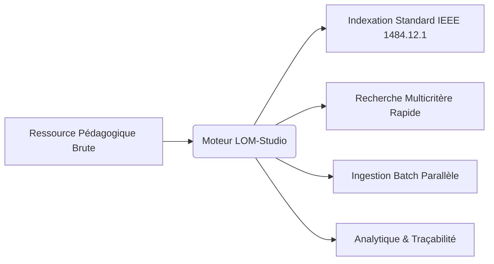
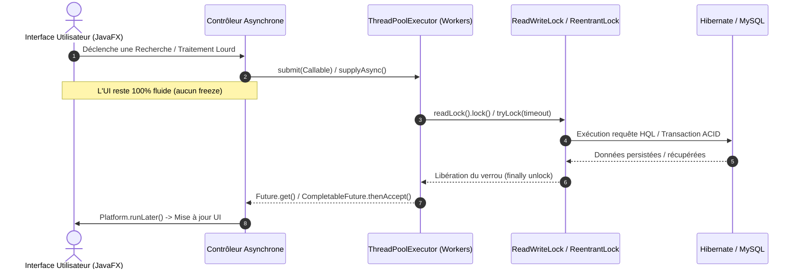

<div align="center">

# 🎓 LOM-Studio | Système de Gestion de Ressources Pédagogiques
### *Implémentation Haute Performance de la Norme IEEE 1484.12.1 (LOM 1.0)*

[](https://openjdk.org/)
[](https://openjfx.io/)
[](https://hibernate.org/)
[](https://www.mysql.com/)
[](https://www.docker.com/)
[](#-architecture-logicielle--design-patterns)
[](LICENSE)

<br/>

**Projet d'Ingénierie Logicielle Avancée & Conception d'Architectures Concurrentes**  
*École Marocaine des Sciences de l'Ingénieur (EMSI) — Casablanca*

---

**Auteur :** [Ilyas Ait Maina](https://github.com/Ilyas0236) &nbsp;|&nbsp; **Superviseur Académique :** Pr. Abderrahim Larhlimi  
*Candidature Stage PFE (Février 2027) & Projet d'Ingénierie Informatique*

</div>

<br/>

## 📌 Sommaire

1. [✨ Présentation & Valeur Métier](#-présentation--valeur-métier)
2. [⚡ Points Forts Techniques (Engineering Highlights)](#-points-forts-techniques-engineering-highlights)
3. [🏛️ Architecture Logicielle & Design Patterns](#️-architecture-logicielle--design-patterns)
4. [🧵 Concurrence & Multithreading (Focus Recruteurs)](#-concurrence--multithreading-focus-recruteurs)
5. [🗄️ Persistance des Données & Hibernate ORM](#️-persistance-des-données--hibernate-orm)
6. [🖥️ Fonctionnalités & Expérience Utilisateur (UI)](#️-fonctionnalités--expérience-utilisateur-ui)
7. [🚀 Démarrage Rapide (Déploiement en 2 minutes)](#-démarrage-rapide-déploiement-en-2-minutes)
8. [📂 Structure Détaillée du Répertoire](#-structure-détaillée-du-répertoire)
9. [📈 Métriques du Projet & Performance](#-métriques-du-projet--performance)
10. [👨‍💻 Profil de l'Auteur & Contact](#-profil-de-lauteur--contact)

---

## ✨ Présentation & Valeur Métier

Dans les écosystèmes universitaires et d'entreprises, les ressources pédagogiques (cours, TP, vidéos, documents interactifs) souffrent généralement de **dispersion**, d'un **déficit d'indexation** et d'une **recherche inefficace**.

**LOM-Studio** est une solution logicielle desktop robuste et découplée, conforme au standard international **IEEE 1484.12.1 (LOM - Learning Object Metadata)**. Elle permet :
- L'indexation normalisée selon les **9 catégories LOM** (Général, Cycle de vie, Métadonnées, Technique, Pédagogie, Droits, Relations, Annotations, Classification).
- Le traitement asynchrone et l'ingestion massive de fichiers via un **moteur multi-thread**.
- Une interface graphique réactive **JavaFX / FXML** connectée via **Hibernate ORM** à une base **MySQL** conteneurisée avec **Docker**.



---

## ⚡ Points Forts Techniques (Engineering Highlights)

Ce projet a été développé en appliquant les **bonnes pratiques de l'ingénierie logicielle**, le respect des principes **SOLID** et l'optimisation des performances :

- **⚡ Concurrence & Multithreading Avancés** : Implémentation manuelle de pools de threads personnalisés (`ThreadPoolExecutor`), barrières de synchronisation (`CountDownLatch`), verrous fins lecture/écriture (`ReadWriteLock`), et tâches non bloquantes (`CompletableFuture`).
- **🏛️ Découplage & Architecture en Couches** : Séparation stricte MVC (Model-View-Controller) avec injection d'accès aux données via Generic DAO.
- **🗃️ Maîtrise Approfondie de l'ORM Hibernate** : Mapping déclaratif pur en fichiers XML (`.hbm.xml`) couvrant plus de **20 entités relationnelles** avec gestion fine du cycle de vie des sessions, prévention des fuites mémoire (`flush`/`clear` périodiques) et requêtes HQL optimisées.
- **🎨 UI Réactive & Asynchrone** : 11 vues FXML découplées sans freeze de l'interface graphique grâce à la synchronisation sur le JavaFX Application Thread via `Platform.runLater()`.
- **🐳 Déploiement Conteneurisé** : Environnement de persistance MySQL 8.0 immédiatement instanciable via Docker Compose avec script d'initialisation DDL (`init.sql`).

---

## 🏛️ Architecture Logicielle & Design Patterns

### 1. Vue d'Ensemble des Couches (Layered Architecture)

```mermaid
flowchart TD
    subgraph PRESENTATION ["Couche Présentation (JavaFX / FXML)"]
        UI[Vues FXML - 11 Écrans]
        CTRL[Contrôleurs JavaFX\nAdmin, User, Search, Upload, Stats...]
    end

    subgraph SERVICE ["Couche Métier & Orchestration Asynchrone"]
        SERVICES[LomService, AuthService, SearchService, StatisticsService...]
        SYNC[DatabaseSyncService\nThreadPoolExecutor | ReadWriteLock | Cache]
        BATCH[BatchImportService\nCountDownLatch | Callable | Future]
    end

    subgraph DAO ["Couche d'Accès aux Données (DAO)"]
        GDAO[GenericDao<T, ID>]
        SDAO[LomSchemaDao, UserDao, TagDao, ClassificationDao]
        HUTIL[HibernateUtil & SessionFactory]
    end

    subgraph PERSISTENCE ["Couche de Persistance"]
        HBM[20+ Fichiers de Mapping XML .hbm.xml]
        DB[(MySQL 8.0 Database\nConteneur Docker)]
    end

    UI --> CTRL
    CTRL -->|Appels Asynchrones Platform.runLater| SERVICE
    SERVICE --> DAO
    DAO --> HUTIL
    HUTIL --> HBM
    HBM --> DB
```

### 2. Design Patterns Implémentés

| Design Pattern | Emplacement & Rôle | Avantage Industriel |
| :--- | :--- | :--- |
| **Singleton** | `HibernateUtil`, `DatabaseSyncService`, `BatchImportService`, `LomService` | Garantit une instance unique pour la gestion des connexions et des pools de threads. |
| **Data Access Object (DAO)** | `GenericDao<T, ID>`, `LomSchemaDao`, `UserDao`, `TagDao` | Isole complètement la logique métier des détails d'implémentation Hibernate/SQL. |
| **Model-View-Controller (MVC)** | Vues FXML (`resources/fxml/`) + Contrôleurs (`ui/controllers/`) | Découplage total entre le design visuel et le code applicatif. |
| **Factory / Error Handler** | `ExceptionHandler`, `LomException` et ses spécialisations | Centralisation et standardisation des exceptions applicatives. |
| **Observer / Listener** | `ImportProgressListener` dans `BatchImportService` | Notification en temps réel de la progression de l'importation batch vers l'IHM. |

---

## 🧵 Concurrence & Multithreading (Focus Recruteurs)

Le projet illustre une **maîtrise complète de l'API `java.util.concurrent`**, essentielle pour concevoir des systèmes d'entreprise scalables et résilients.



### Détail des Composants Concurrents :

1. **Pools de Threads Dédiés (`ThreadPoolExecutor`)** :
   - Dimensionnés avec `corePoolSize`, `maxPoolSize`, `keepAliveTime`, et une file bornée `LinkedBlockingQueue` pour éviter la surcharge mémoire.
   - Utilisation de `ThreadFactory` personnalisée produisant des **threads démons nommés** pour ne jamais bloquer l'arrêt de la JVM.

2. **Synchronisation Fine (`ReentrantReadWriteLock`)** :
   - **Lectures concurrentes** : Plusieurs threads peuvent consulter le cache et les métadonnées simultanément sans contention.
   - **Écritures exclusives** : Blocage atomique lors de la création ou mise à jour pour garantir l'intégrité référentielle.

3. **Prévention des Interblocages (Deadlocks) avec `ReentrantLock.tryLock()`** :
   - Application d'un timeout sur les opérations critiques de suppression (`deleteResourceWithTimeout`).

4. **Synchronisation par Barrière (`CountDownLatch`)** :
   - Chargement et contrôle simultané de N ressources avec attente coordonnée de la complétion du groupe de threads.

5. **Structures de Données Thread-Safe** :
   - `ConcurrentHashMap` : Cache mémoire de premier niveau haute performance.
   - `CopyOnWriteArrayList` : Agrégation des résultats d'ingestion multi-thread sans `ConcurrentModificationException`.
   - `AtomicInteger` : Métriques et compteurs d'accès sans verrouillage lourd.

---

## 🗄️ Persistance des Données & Hibernate ORM

Contrairement aux configurations basiques via annotations automatiques, ce projet utilise le **mapping XML natif (`.hbm.xml`)**, attestant d'une compréhension fine du fonctionnement interne des moteurs ORM d'entreprise :

```
src/main/resources/
├── hibernate.cfg.xml          # Configuration du Dialect, Connection Pool, Cache
├── LomSchema.hbm.xml          # Agrégat racine LOM 1.0
├── General.hbm.xml            # Catégorie 1 : Titre, Langue, Description, Mots-clés
├── Lifecycle.hbm.xml          # Catégorie 2 : Version, Statut, Contributeurs
├── Technical.hbm.xml          # Catégorie 4 : Format, Taille, Emplacement, Prérequis
├── Educational.hbm.xml        # Catégorie 5 : Type d'interactivité, Niveau, Âge
├── Classification.hbm.xml     # Catégorie 9 : Taxonomies, Arbres de taxons
└── ... (20+ entités au total)
```

### Bonnes Pratiques Transactionnelles :
- **Gestion stricte des transactions ACID** : `beginTransaction()`, `commit()`, et `rollback()` systématique dans les blocs `catch`.
- **Traitement par lots optimisé (Batch Processing)** : Nettoyage périodique du contexte de persistance (`session.flush()` et `session.clear()`) tous les 20 enregistrements afin de maîtriser l'empreinte mémoire heap.

---

## 🖥️ Fonctionnalités & Expérience Utilisateur (UI)

### Matrice des Droits & Rôles

| Fonctionnalité | Espace Administrateur | Espace Utilisateur (Étudiant/Enseignant) |
| :--- | :---: | :---: |
| **Authentification & Session Sécurisée** | ✅ | ✅ |
| **Consultation & Détails Complets LOM** | ✅ | ✅ |
| **Recherche Multicritère Dynamique** | ✅ | ✅ (Filtres langue, niveau, mot-clé) |
| **Gestion des Favoris & Historique de vue** | ✅ | ✅ (Sauvegardé en BDD) |
| **Système de Notation (Étoiles 1-5)** | ✅ | ✅ |
| **Téléchargement de Fichiers Pédagogiques**| ✅ | ✅ |
| **Création / Édition / Suppression CRUD LOM**| ✅ | ❌ |
| **Import Massif CSV Parallélisé (Batch)** | ✅ (Suivi temps réel) | ❌ |
| **Gestionnaire Global des Tags** | ✅ | ❌ |
| **Dashboard Analytique & Graphiques** | ✅ (Répartition par langue, type...) | ❌ |

---

## 🚀 Démarrage Rapide (Déploiement en 2 minutes)

### Prérequis Système
- **Java Development Kit (JDK)** : Version **21 LTS** ou supérieure.
- **Apache Maven** : 3.8+
- **Docker Desktop** : Actif et en cours d'exécution.

### 1. Cloner le Dépôt
```bash
git clone https://github.com/Ilyas0236/projet-java-aitmaina.git
cd projet-java-aitmaina
```

### 2. Démarrer la Base de Données Conteneurisée
```bash
# Lancement de MySQL 8.0 et initialisation automatique du schéma
docker-compose -f docker/docker-compose.yml up -d
```

### 3. Compiler et Lancer l'Application
```bash
mvn clean javafx:run
```

### 🔑 Identifiants Pré-Configurés

> [!NOTE]
> La base de données est automatiquement injectée avec deux profils pour tester l'ensemble des scénarios :

| Profil | Login | Mot de passe | Privilèges |
| :--- | :--- | :--- | :--- |
| **Administrateur** | `admin` | `admin` | Accès complet : Gestion CRUD, Batch, Tags, Analytique |
| **Utilisateur** | `user` | `user` | Consultation, Recherche avancée, Favoris, Historique |

---

## 📂 Structure Détaillée du Répertoire

```
projet-lom/
├── 🐳 docker/
│   ├── docker-compose.yml       # Configuration du conteneur MySQL 8
│   └── init.sql                 # Script DDL d'initialisation des tables et données de test
│
├── 📦 src/main/java/org/emsi/
│   ├── 🚀 MainApp.java           # Point d'entrée JavaFX
│   ├── 🧱 entities/             # 20+ Modèles de données conformes LOM 1.0
│   │   ├── LomSchema.java       # Entité racine
│   │   ├── General.java, Educational.java, Technical.java...
│   │   └── User.java, Tag.java, Favorite.java, Rating.java...
│   ├── 💾 dao/                  # Couche d'accès aux données
│   │   ├── GenericDao.java      # DAO générique réutilisable
│   │   ├── HibernateUtil.java   # Gestionnaire de SessionFactory
│   │   └── LomSchemaDao.java, UserDao.java, TagDao.java...
│   ├── ⚙️ service/              # Couche Logique Métier & Multithreading
│   │   ├── DatabaseSyncService.java # Gestionnaire concurrent (Locks, ThreadPool, Cache)
│   │   ├── BatchImportService.java  # Moteur d'ingestion massive multi-thread
│   │   ├── StatisticsService.java   # Calculs statistiques via Java Streams
│   │   └── SearchService.java, AuthService.java, FileStorageService.java...
│   ├── 🖥️ ui/                   # Contrôleurs & Logique de présentation
│   │   └── controllers/         # 11 Contrôleurs FXML (Admin, User, Search, Stats...)
│   └── ⚠️ exceptions/           # Hiérarchie typée des exceptions métier
│
├── 🎨 src/main/resources/
│   ├── 📄 fxml/                 # 11 Définitions d'interfaces graphiques FXML
│   ├── 🗺️ *.hbm.xml             # 20+ Fichiers de mapping Hibernate XML
│   └── ⚙️ hibernate.cfg.xml     # Configuration de connexion ORM
│
├── 📋 pom.xml                   # Dépendances Maven (JavaFX, Hibernate, MySQL, Jackson)
└── 📖 README.md                 # Documentation technique professionnelle
```

---

## 📈 Métriques du Projet & Performance

- **Langage & Runtime** : Java 21 LTS (Modern Switch Expressions, Records, Streams API)
- **Modèle de Données** : 20+ Tables relationnelles reliées en cascades intègres
- **Vues Graphiques** : 11 Interfaces FXML modulaires avec CSS moderne
- **Concurrence** : Traitement par lots (Batch Import) non-bloquant capable d'absorber des centaines d'enregistrements en parallèle avec tolérance aux pannes.
- **Code Cleanliness** : Couplage faible, cohésion forte, journalisation claire des flux de threads.

---

## 👨‍💻 Profil de l'Auteur & Contact

Ce projet a été conçu et réalisé par :

<div align="center">

### **Ilyas Ait Maina**
*Élève-Ingénieur en 5e année — Informatique & Systèmes d'Information*  
**École Marocaine des Sciences de l'Ingénieur (EMSI Casablanca)**

[](https://github.com/Ilyas0236)
[](https://linkedin.com/in/ilyas-ait-maina-b5998b1b4)
[](mailto:ilyasaitmaina@gmail.com)

</div>

<br/>

---

<div align="center">
<sub>Projet académique réalisé sous la direction de <b>Pr. Abderrahim Larhlimi</b> — EMSI 2025/2026. Tous droits réservés.</sub>
</div>
